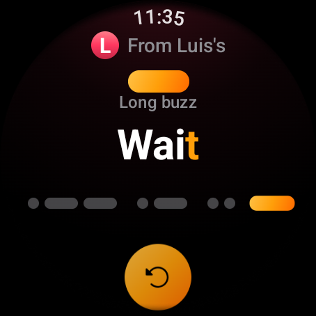
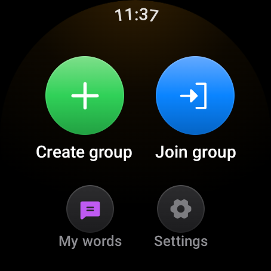
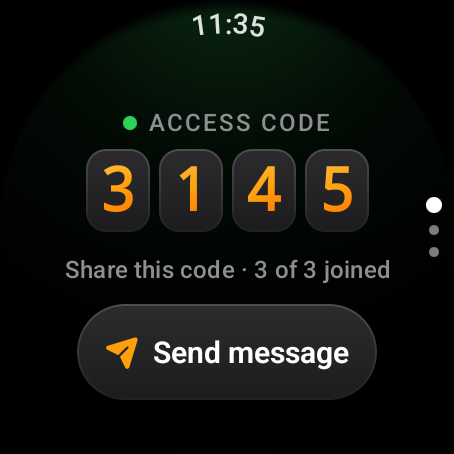
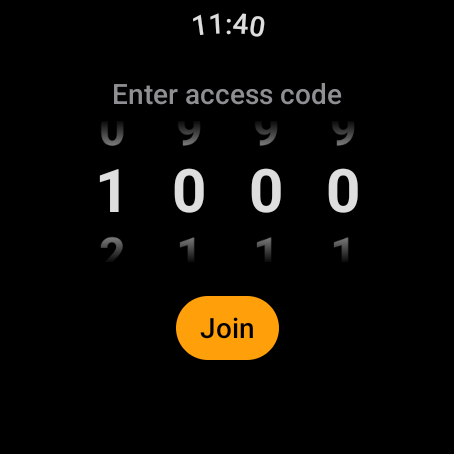
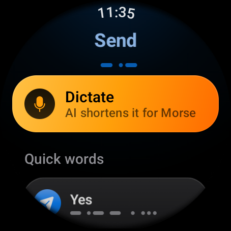
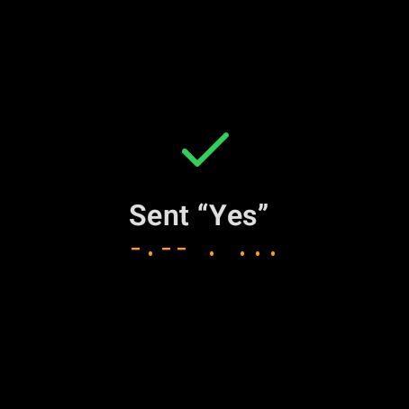
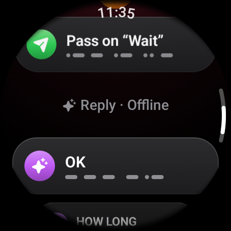
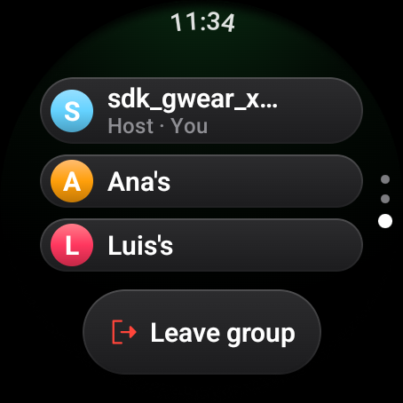
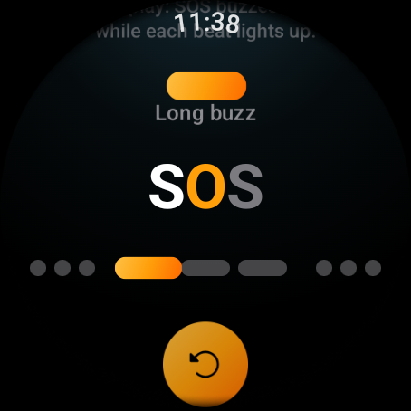
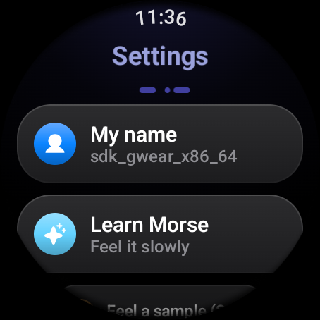

# Morse

### Silent messages you feel on your wrist.

A Wear OS app for small groups that talk without speaking. Pick a word, send it,
and it arrives on your friends' watches as a Morse vibration they can read by
feel, no need to look at the screen.

[Features](#what-you-can-do) · [Tour](#a-quick-tour) · [Install](#install) · [User guide](docs/user-guide/getting-started.md) · [Documentation](docs/README.md)

 

 

## What is Morse?

Morse is a native Wear OS app for groups of up to three watches. One person
creates a group and shares a 4-digit code, the others join, and from then on
every word anyone sends plays on everyone else's wrist as a haptic Morse
pattern.

The vibration is the message. The screen shows the dots and dashes in sync with
the buzz, so you learn to recognise words by feel and soon don't need to look at
all. It is made for places where phones or voices are out of place: a class, a
meeting, a theatre, a noisy room.

Morse started as a university interface-design project.

 

## What you can do

<table>
<tr>
<td width="50%" valign="top">

**Groups of three**

Create a group, share the access code, and up to three watches are connected
over Wi-Fi Direct. No phone, account or internet needed.

</td>
<td width="50%" valign="top">

**Feel every message**

Incoming words play as short and long vibrations, with the Morse lit up on
screen as it plays. Replay it, reply, or pass it on to the group.

</td>
</tr>
<tr>
<td valign="top">

**Your own words**

A ready-made list of short words plus your own. Sending one is a single tap,
and you always know whether it went out.

</td>
<td valign="top">

**Dictate**

Say a sentence and AI condenses it to 20 characters or fewer, because each
letter costs about a second of vibration. You see how much time it saved.

</td>
</tr>
<tr>
<td valign="top">

**Smart replies**

Three one-tap replies based on the latest messages in the group, online with
Gemini or offline with built-in rules.

</td>
<td valign="top">

**Stays out of your way**

A message that arrives while you are busy doesn't pull you off your screen: the
watch edge pulses with the Morse instead.

</td>
</tr>
<tr>
<td valign="top">

**Learn by feel**

A slow, narrated SOS teaches the rhythm, and every event (connected, sent,
someone left) has its own vibration that never sounds like a letter.

</td>
<td valign="top">

**Fits every watch**

Round and square, small and large, English and Spanish, large text and
TalkBack, in a dark watchOS-style look.

</td>
</tr>
</table>

 

## A quick tour

<table>
<tr>
<td align="center" width="33%"></td>
<td align="center" width="33%"></td>
<td align="center" width="33%"></td>
</tr>
<tr>
<td align="center">Home: create or join a group</td>
<td align="center">The host shares a 4-digit code</td>
<td align="center">Others dial it in to join</td>
</tr>
<tr>
<td align="center"></td>
<td align="center"></td>
<td align="center"></td>
</tr>
<tr>
<td align="center">Every word shows its Morse</td>
<td align="center">A clear answer on every send</td>
<td align="center">Pass it on or reply in one tap</td>
</tr>
<tr>
<td align="center"></td>
<td align="center"></td>
<td align="center"></td>
</tr>
<tr>
<td align="center">Who is in the group</td>
<td align="center">Learn the rhythm slowly</td>
<td align="center">Name, language, signals</td>
</tr>
</table>

 

## How it works

- **Connection.** The host watch becomes a Wi-Fi Direct group owner and
  advertises its access code. Joiners discover it, connect, then talk to it
  over plain TCP (port 8765), one JSON line per message. The host relays every
  word to the others. A LAN mode uses the same socket layer with a typed host
  address, so emulators and the PC tools can join too.
- **Vibration.** Words are encoded to International Morse (plus Ñ) and played
  at 120 ms per beat. The same timing drives the screen, so the light and the
  buzz stay together.
- **Background.** While you are in a group a foreground service keeps the
  connection alive with the screen off.
- **AI.** Dictation and smart replies use the Gemini API (free tier). Without a
  key or without internet they fall back to offline rules, so they always work.
- **Builds.** `full` is the real app. `demo` simulates the other watches, for
  showing the app on a single watch or emulator.

The full story, layer by layer, is in [How it works](docs/README.md#how-it-works).

 

## Install

You need a Wear OS watch or emulator (Wear OS 3+, API 30+) and the Android SDK
or Android Studio.

| I want to... | Run from the project folder |
|--------------|-----------------------------|
| Install the real app | `./gradlew :app:installFullDebug` |
| Install the demo with simulated watches | `./gradlew :app:installDemoDebug` |
| Run the unit tests | `./gradlew testFullDebugUnitTest` |
| Run the smoke test on a connected watch | `./gradlew connectedDemoDebugAndroidTest` |
| Host a group of bots on my PC | `python3 tools/morse_sim.py` |
| The same, with a web control panel | `python3 tools/morse_panel.py` |

To turn on online AI, get a free key at
[aistudio.google.com/apikey](https://aistudio.google.com/apikey) and add a line
`GEMINI_API_KEY=` with your key to `local.properties` (it is gitignored).

Installing on a real watch over Wi-Fi debugging is explained step by step in
[Building and running](docs/development/building.md), and every way to demo
without three watches is in [Demo and emulators](docs/development/demo-and-emulators.md).

 

## Good to know

- **Groups are local.** Messages go watch to watch. Nothing is stored on a
  server; the only outside connection is to Gemini when you use the AI features
  with a key.
- **Up to three watches per group**, and the access code is checked on join.
- **Wi-Fi Direct needs the Nearby devices permission**, which the app asks for
  before looking for other watches. Some watches do not offer Wi-Fi Direct; the
  LAN mode works on a shared Wi-Fi network instead.
- **Joining takes about ten seconds** over Wi-Fi Direct, while the watches find
  each other over the air. Join one watch at a time.

 

## Documentation

| I want to... | Read |
|--------------|------|
| Learn how to use the app | [User guide](docs/user-guide/getting-started.md) |
| Learn to read Morse by feel | [Reading Morse by feel](docs/user-guide/reading-morse.md) |
| Fix a problem | [Troubleshooting](docs/user-guide/troubleshooting.md) |
| Understand how watches connect | [Connection](docs/internals/connection.md) |
| Understand how it works inside | [Documentation index](docs/README.md) |
| Build it, test it or demo it | [Development](docs/README.md#development) |

## License

[MIT](LICENSE)

 
Made by Juan Diego López Arias

