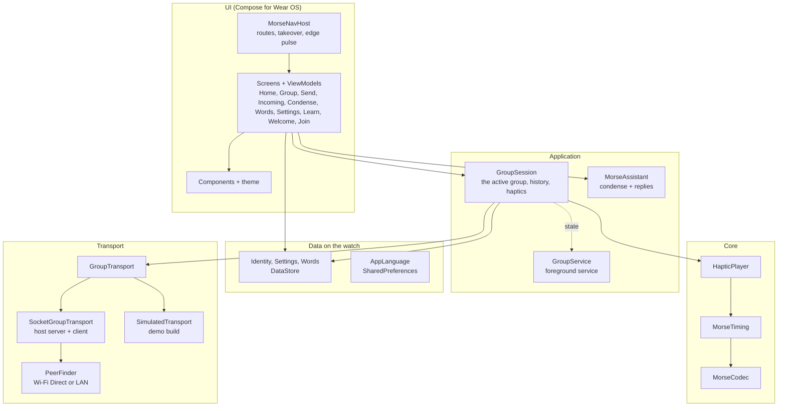
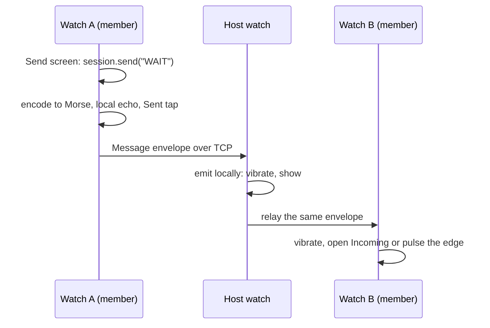

# Architecture overview

Morse is a single-module, standalone Wear OS application written in Kotlin with
Jetpack Compose for Wear OS. It has no phone companion, no backend and no
database server. Everything a group needs runs on the watches themselves.

The code is organised in layers. Each layer only knows the one below it, and
the transport layer hides how watches find each other behind a small
interface, so the rest of the app is identical over Wi-Fi Direct, the local
network or the simulated demo group.

## Packages

All code lives under `com.morse.wearos` in `app/src/main/kotlin`.

| Package | Responsibility | Main types |
|---------|----------------|-----------|
| (root) | Process and activity entry points | `MorseApp` builds the container and starts or stops the foreground service; `MainActivity` applies the language and shows the navigation host. |
| `di` | Manual dependency injection | `AppContainer` creates every long-lived object once, lazily; `containerViewModel` builds ViewModels from it. |
| `domain` | Plain data shared by every layer | `Member`, `MorseMessage`, `GroupInfo`, `ConnectionState`, `TransportError`, `GroupConfig` limits, name cleaning and shortening. |
| `core.morse` | Turning text into Morse and Morse into time | `MorseCodec`, `MorseTiming`, `MorseStep`. |
| `core.haptics` | The vibration motor | `HapticPlayer`, `HapticSignal`. |
| `group` | The active group for the whole app | `GroupSession`, `GroupService`. |
| `transport` | Moving messages between watches | `GroupTransport`, `PeerFinder`, `Protocol` and `Envelope`, `AccessCode`. |
| `transport.socket` | The TCP layer shared by real modes | `SocketGroupTransport`, `GroupHostServer`, `GroupClient`, `EnvelopeSocket`. |
| `transport.wifidirect` | Finding the host over the air | `WifiDirectPeerFinder`, the permission it needs. |
| `transport.lan` | Finding the host at a fixed address | `LanPeerFinder`. |
| `ai` | Short text for haptic Morse | `MorseAssistant`, `Suggestion`. |
| `data` | What the watch remembers | `IdentityRepository`, `SettingsRepository`, `WordsRepository`, `AppLanguage`, `DefaultWords`. |
| `ui.navigation` | Routes and the navigation host | `Routes`, `MorseNavHost`. |
| `ui.screens.*` | One package per screen, each with its ViewModel | `home`, `welcome`, `join`, `group`, `send`, `condense`, `incoming`, `words`, `settings`, `learn`. |
| `ui.components` | Shared building blocks | `MorseScaffold`, `Platter`, `MorseGlyphs`, `PulseBorder`, send feedback, text input, responsive helpers. |
| `ui.theme` | Colours, gradients, type, motion | `MorseTheme`, `MorseColors`, `MorseGradients`. |

## Build flavours

The app has one flavour dimension, `mode`, with two flavours. They share every
screen, the session and the protocol; only the transport differs.

| Flavour | Application id | Transport | Extra source set |
|---------|----------------|-----------|------------------|
| `full` | `com.morse.wearos` | Wi-Fi Direct or LAN, chosen in Settings | `app/src/full`: declares that this is not the demo and offers no demo transport. |
| `demo` | `com.morse.wearos.demo` | Always `SimulatedTransport` | `app/src/demo`: the simulated group and the fake member names, in English and Spanish. |

The flag that tells them apart is a compile-time constant, `IS_DEMO`, defined
once in each flavour's source set. It hides the connection settings in the demo
and skips the Wi-Fi Direct permission request.

## How objects are wired

There is no injection framework. `MorseApp` creates one `AppContainer` when the
process starts and every screen reaches it through the application context.

| Object | Lifetime | Created with |
|--------|----------|--------------|
| `HapticPlayer` | Process | The application context, to reach the system vibrator. |
| `IdentityRepository`, `SettingsRepository`, `WordsRepository` | Process | The application context, each over its own DataStore file. |
| `MorseAssistant` | Process | The Gemini key compiled into `BuildConfig`. |
| `GroupSession` | Process | A factory that builds a transport for a connection mode, plus identity, settings and haptics. |
| A `GroupTransport` | One group | Built by the session each time you create or join, so a change of connection mode applies to the next group. |
| ViewModels | One screen | `containerViewModel` with the objects that screen needs. |

Because the session lives for the whole process, the group survives screen
changes, rotation of the activity and the screen turning off. The foreground
service exists to keep that process alive; see
[Group session](../internals/group-session.md).

## Data flow in one message

Each step is described in depth in the internals pages:
[Connection](../internals/connection.md),
[Group session](../internals/group-session.md) and
[Morse and haptics](../internals/morse-and-haptics.md).

## Technology

| Area | Choice |
|------|--------|
| Language | Kotlin, Java 8 bytecode |
| UI | Jetpack Compose with Wear Compose Material and Wear Compose Navigation 1.3 |
| Concurrency | Kotlin coroutines and flows |
| Storage | Jetpack DataStore (preferences), plus one SharedPreferences file for the language |
| Serialisation | kotlinx.serialization JSON |
| Networking | Plain Java sockets and `WifiP2pManager` |
| Text input | Wear `RemoteInput` (voice, keyboard, handwriting) |
| AI | Gemini REST API over `HttpURLConnection`, no SDK |
| Minimum and target | API 30 to API 35 |
