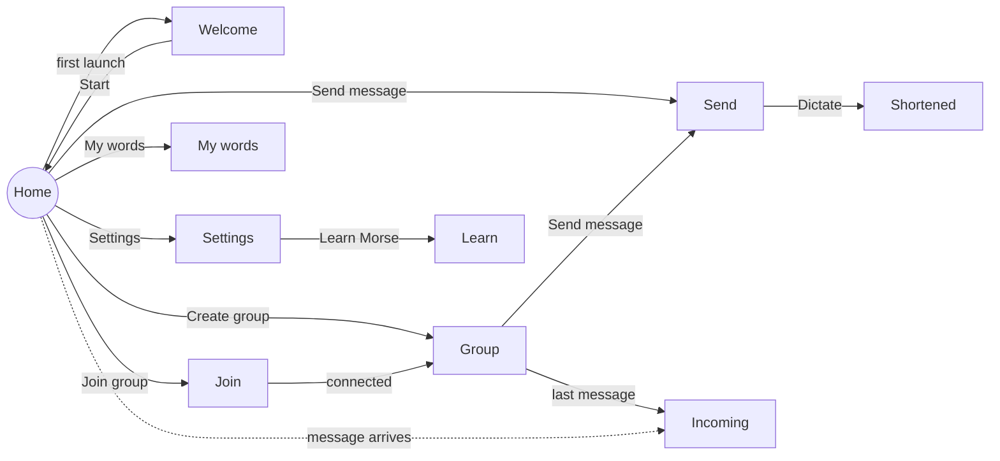

# Screens and navigation

Morse has ten screens. They are destinations in a single Wear navigation host,
so the system swipe-to-dismiss gesture (swiping from the left edge) and the
Back button always take you one step back.

## The map

| Route | Screen | Opened from | Leaves to |
|-------|--------|-------------|-----------|
| `home` | Home | App start | Every other screen |
| `welcome` | Welcome | Home, automatically, on first launch | Back to Home with **Start** |
| `join` | Join | Home | Group, replacing Join so Back from Group returns to Home |
| `group` | Group | Home (create or chip), Join | Send, Incoming, Home after leaving |
| `send` | Send | Home, Group | Back where it came from after a send; Home when not in a group |
| `condense/{text}` | Shortened | Send, with the dictated text in the route | Back past Send to wherever Send was opened from |
| `incoming` | Incoming | A message arriving, or the last message in Group | Back after replying |
| `words` | My words | Home | Back |
| `settings` | Settings | Home | Learn, Back |
| `learn` | Learn Morse | Settings | Back |

The dictated text travels inside the `condense` route, URL-encoded, so the
Shortened screen can be rebuilt from its route alone.

## When an incoming message takes over

The navigation host is also where incoming messages are routed, because it is
the one place that knows which screen is showing. It listens to the session's
stream of messages from other members and decides:

| Situation | What happens |
|-----------|--------------|
| On Home or already on Incoming | Navigate to Incoming (single top, so it is reused, not stacked). |
| The app is not visible (in the background, screen off) | Navigate to Incoming, so it is there when the watch is raised. |
| On any other screen | Stay. Light the green edge ring in time with the Morse instead. |

The ring is a separate layer drawn over the whole navigation host. It replays
the message's timing steps (on and off durations) and is fully transparent
the rest of the time, so it never blocks touches. If a newer message arrives
while the ring is still playing, the old playback is cancelled and the new one
takes over. The vibration itself is not decided here: the session has already
started it, whatever the screen.

## Screens in detail

### Home

Not a list, but a hub of round buttons sized for a glance. With no group it
shows **Create group** (green) and **Join group** (blue). In a group it shows a
single orange orb, **Send message**, and a chip with the code and member count
that opens the group. The orb's label is hidden on small watches and at large
font scales to leave room for the chip; the orb keeps its spoken label for
TalkBack.

Home stays blank until it has read from storage whether the welcome was
already seen, so the very first launch goes straight to the welcome without a
flash of Home. Creating or joining over Wi-Fi Direct is guarded by the Nearby
devices permission request.

### Welcome

A list with the beacon, the word, its Morse, the replay button, the name row
and **Start**. The ViewModel marks the welcome as seen as soon as the screen
opens, so dismissing it by swiping also counts.

### Join

Four Wear pickers, one per digit, and a **Join** chip. The screen has three
states driven by the session: picking, connecting (a spinner) and error (the
reason and **Try again**). It navigates to Group only after a join that this
screen started reaches Connected.

### Group

A vertical pager with three pages: the code, the messages and the people. The
start page depends on the role, read synchronously from the session so the
first frame is already right: the host starts on the code, a member on the
messages. When the group fills up while the host is still on the code page,
the pager scrolls itself to the messages. Leaving asks for confirmation in a
Wear alert, with a different explanation for the host.

### Send

A scrolling list: the "not in a group" row (only when disconnected), Dictate,
the quick words and your words. Every word row shows its Morse. Sending goes
through a shared helper that shows a confirmation or a retry alert, described
in [Design system](design-system.md#send-feedback).

### Shortened

Shows the dictated sentence, a spinner while the suggestion is prepared, then
the suggestion, the buzz-time comparison and, when it fits, the original.

### Incoming

The most specific screen of the app: sender, beacon, revealed word, Morse
visualiser and replay, then Pass on and smart replies. The playback state is
computed on the screen from the same timing steps the motor uses, which is
what keeps the light and the buzz in step. See
[Morse and haptics](../internals/morse-and-haptics.md#keeping-the-screen-in-step).

### My words, Settings, Learn

Standard scrolling lists built from the shared row component. Settings
recreates the activity when the language changes, which reloads every string
without restarting the app.

## Adapting to the watch

Every screen is designed for round and square faces from about 1.2 to over
1.4 inches.

| Technique | Where |
|-----------|-------|
| Margins as a percentage of the screen width, wider on round faces where the corners are cut | Every list screen through the shared scaffold |
| A compact mode below 200 dp wide: smaller digits, buttons and Morse dots | Home, Join, Group, Incoming, Welcome, Learn |
| Titles centred on round faces, left-aligned on square ones | Shared scaffold |
| Extra bottom inset on round faces so labels stay inside the bezel | Home |
| Lists that can scroll their last item up to the middle of the face | Shared scaffold |
| A scaling list that shrinks items near the edges, with a position indicator | Every list screen |

The time is shown at the top of every screen, as Wear OS expects.
