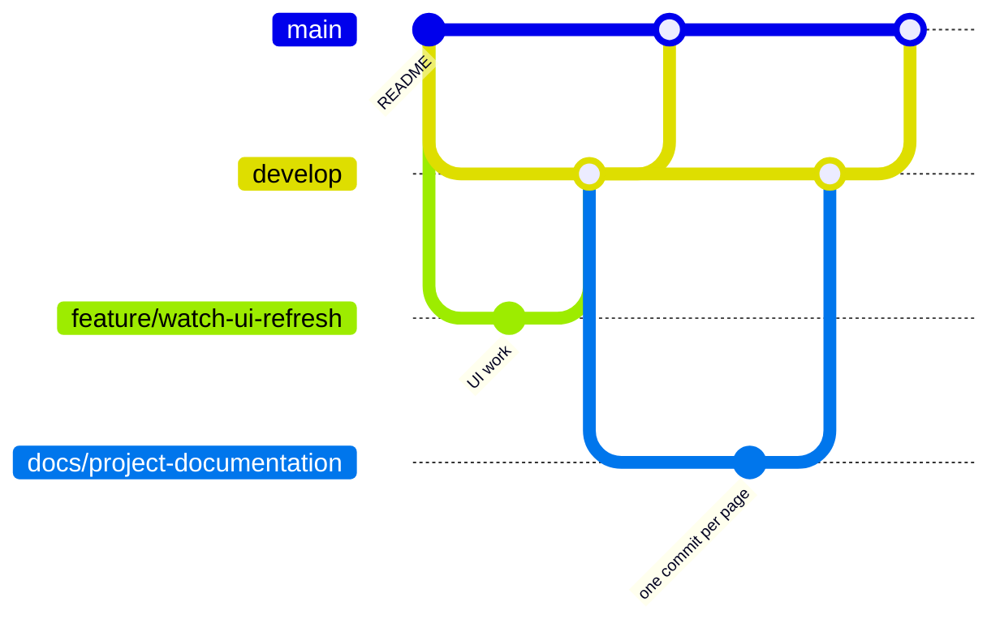

# Git workflow

The history uses two long-lived branches and one short-lived branch per piece
of work, always joined with merge commits, so the graph shows one bump per
feature with its individual commits underneath.

| Branch | Purpose |
|--------|---------|
| `main` | What is presented and installed. Only receives merges from `develop`. |
| `develop` | Integration. Work branches are merged here first. |
| `feature/…` | User-facing functionality, for example `feature/watch-ui-refresh`. |
| `fix/…` | A bug fix that stands on its own. |
| `impeccable/…` | Design review passes and the fixes they produce, for example `impeccable/critique-fixes`. |
| `docs/…` | Documentation only, for example `docs/project-documentation`. |
| `chore/…` | Tooling and project setup. |

## Each piece of work

1. Branch from the latest `develop` (or `main` when `develop` is behind).
2. Make **one commit per change**: one fix, one document, one feature step.
   Stage only the files that belong to it.
3. Write the first line of the message as an imperative summary of what
   changed ("Add the testing guide", "Raise Group pill buttons to the 48dp
   minimum touch target"). Use the body to say why, and what was wrong before
   when it is a fix.
4. Merge the branch into `develop` with a merge commit (no fast-forward), then
   merge `develop` into `main` the same way.
5. Push `develop`, `main` and the work branch.

Commits carry only the author's name. No co-author or tool attribution
trailers are added.

## Before merging

- `./gradlew testFullDebugUnitTest testDemoDebugUnitTest` passes.
- `./gradlew lintFullDebug` reports no errors.
- For UI changes, the screens were checked on a Wear emulator or watch, at
  normal and large font sizes. When a watch is connected, the smoke test
  passes: see [Testing](testing.md).
- New strings exist in English and Spanish.

## What is never committed

| Path | Why |
|------|-----|
| `local.properties` | Holds the SDK path and the Gemini key |
| `build/`, `.gradle/` | Generated by Gradle |
| IDE caches under `.idea/` | Machine-specific |
| `__pycache__/` | Generated by Python |

See `.gitignore` at the repository root.
