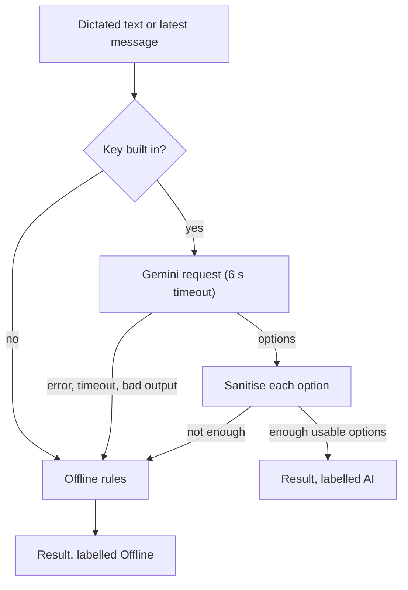

# AI assistant

Every letter costs about a second of vibration, so Morse only works with very
short text. The assistant helps in two places:

- **Condense:** turn a dictated sentence into 20 characters or fewer.
- **Smart replies:** suggest three one-tap answers to the latest message.

Both use Google's **Gemini** API when the build has a key and the watch is
online, and fall back to built-in rules otherwise. The fallback always answers,
so neither feature can dead-end, and every result is labelled **AI** or
**Offline** on screen so you know where it came from.

## The model call

| Setting | Value |
|---------|-------|
| Model | `gemini-2.5-flash-lite`, available on the free tier |
| Endpoint | The Generative Language API's generate-content method |
| Authentication | The key in the `x-goog-api-key` header, never in the URL |
| Timeouts | 6 seconds to connect and 6 seconds to read |
| Temperature | 0.4, enough variety for three different replies while staying on topic |
| Output | JSON only, constrained by a response schema: an object with an `options` array of strings |

The request is built by hand and sent with the platform's HTTP client, so the
app needs no AI SDK. Any non-200 status, network error, timeout or unexpected
shape is caught, logged under `MorseAssistant`, and treated as "no answer".

### The instructions

A system instruction, sent with every request, tells the model the rules of
the medium:

- People are talking through watches that vibrate each message as Morse.
- Each letter costs about a second, so text must be as short as possible.
- Write telegraph style: drop articles and filler, use digits and common
  abbreviations such as OK, MIN, ETA and ASAP.
- At most 20 characters per option, only letters, digits and spaces, no emoji.
- Keep who, where, when and yes or no. Never invent facts.
- Answer in the app's current language.
- Return exactly the requested number of options.

The language is read at the moment of each call, so changing it in Settings
applies to the next suggestion without a restart.

## Condense

The prompt is the dictated text. One option is requested. If the model
returns a usable one it is shown as **AI**; otherwise the offline condenser
runs.

The Shortened screen also measures both versions in seconds of vibration,
computed from the same timing steps the motor uses, and offers the original
when it already fits in 20 characters.

## Smart replies

The prompt contains the group conversation so far, up to the last ten
messages, one per line as "name: word", oldest first, followed by the message
to answer and its sender. Three options are requested.

The model's answer is used only if at least **two different** options survive
sanitising, and at most three are kept. Otherwise the offline replies are used.
Replies are prepared only for messages from other people, and a newer message
cancels the request for an older one.

## Sanitising

Model output and dictated text are both treated as untrusted. Every option goes
through the same cleaner before it can be sent:

1. Upper-case it.
2. Replace every character that has no Morse code (except the apostrophe, kept
   for words like I'M) with a space.
3. Trim and collapse spaces.
4. If longer than 20 characters, cut at the last space that fits; if there is
   none, cut at 20.
5. Reject it if nothing encodable is left.

So whatever the model writes, what reaches the group is always short, always
playable and never contains emoji or markup.

## The offline rules

### Condensing

1. Split into words and replace units and common words by abbreviations:
   minutes and minutos become MIN, hours and horas H, seconds and segundos S,
   okay OK, tomorrow TMRW, please PLS.
2. Remove filler words in English and Spanish: articles, pronouns,
   prepositions and verbs like "am", "is", "going", "estoy", "voy".
3. Clean each remaining word and add words in order while the result still fits
   in 20 characters.
4. If every word was filler, use the words as they were; if nothing is left at
   all, send OK.

"I will be there in ten minutes please wait" becomes "TEN MIN PLS WAIT".

### Replies

Keyword rules, in order, with the first match winning. Matching ignores case
and punctuation.

| The message contains | English replies | Spanish replies |
|----------------------|-----------------|-----------------|
| sos, help, ayuda, auxilio | ON MY WAY, WHERE, CALL 911 | VOY, DONDE, LLAMO 911 |
| where, donde, dónde | I'M HERE, HOME, ON MY WAY | AQUI ESTOY, CASA, VOY EN CAMINO |
| when, cuando, cuándo | NOW, 5 MIN, LATER | YA, 5 MIN, LUEGO |
| wait, espera | OK, HOW LONG, CAN'T | OK, CUANTO, NO PUEDO |
| a question mark, or a question word such as are, can, do, puedes, vienes | YES, NO, MAYBE | SI, NO, QUIZAS |
| anything else | OK, THANKS, WAIT | OK, GRACIAS, ESPERA |

The PC simulator's bots use the same rules to answer, so a demo without a key
behaves the same on the watch and on the computer.

## Privacy and the key

- **No key, no traffic.** Without a key the assistant never opens a network
  connection, and Settings says "Smart replies: basic (offline)".
- **What is sent.** With a key, the dictated text, and for replies the last ten
  messages with sender names, are sent to Google. Nothing else.
- **Free tier.** Google may use free-tier prompts to improve its models. Keep
  that in mind for sensitive conversations.
- **The key is in the app.** It is compiled into the build from
  `local.properties`, which is not committed. Anything inside an APK can be
  extracted, so restrict the key to the Generative Language API in the Google
  Cloud console and do not reuse it elsewhere.

How to add a key is in
[Building and running](../development/building.md#turning-on-online-ai).
