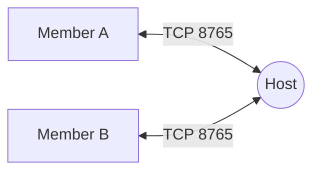
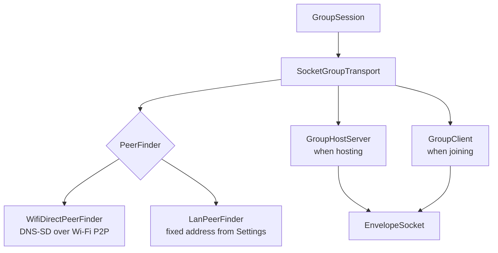
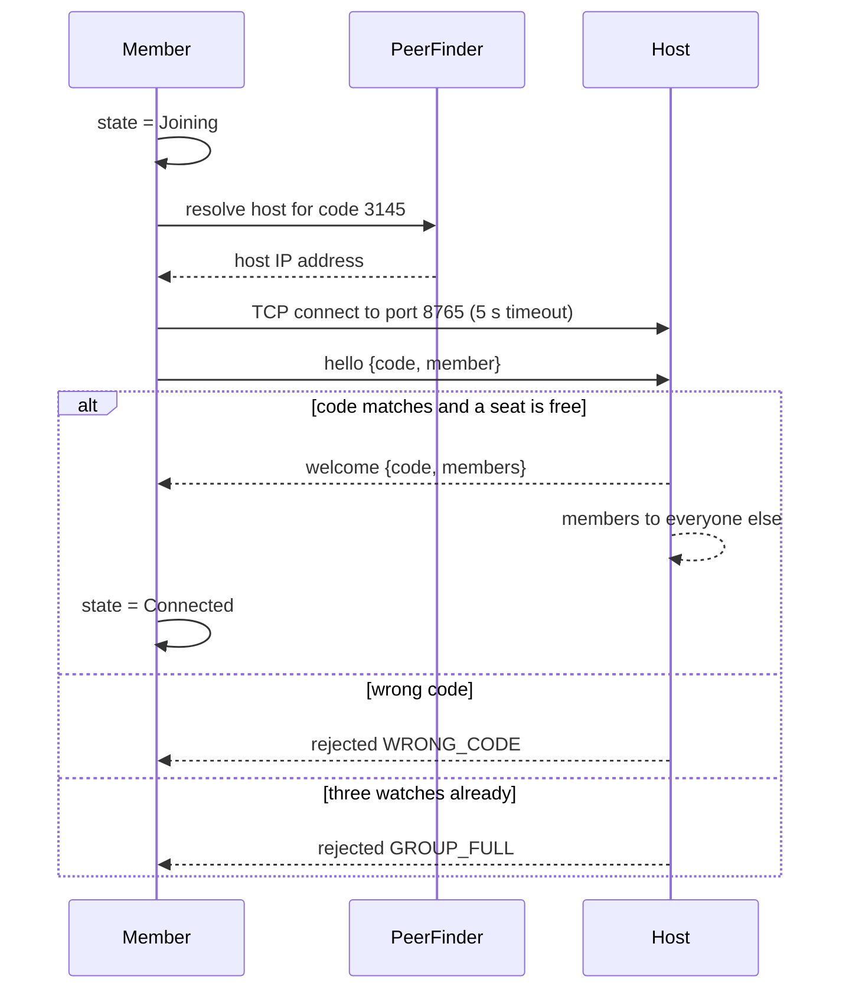
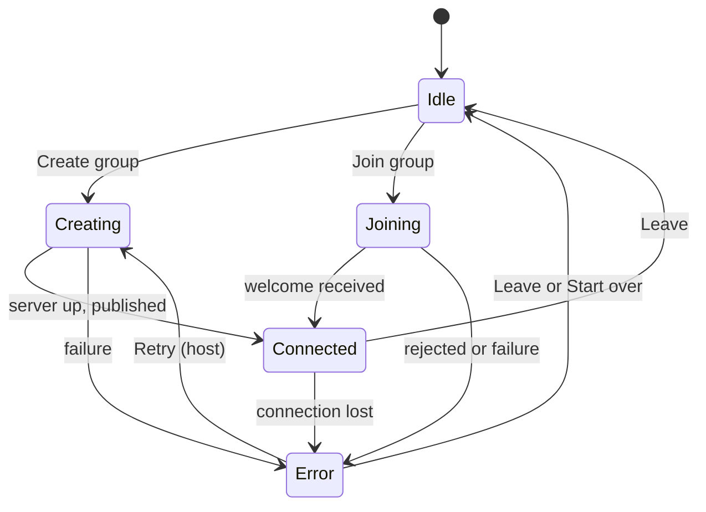

# Connection: how watches talk to each other

A Morse group is a small **star network**. The watch that creates the group is
the **host**: it runs a TCP server on port 8765. Every other watch is a
**member** that opens one TCP connection to the host. Members never talk to
each other directly; the host relays every message to everyone else.

A star suits a group of three: one hop from a member to the host, two hops
from member to member, and a single place that owns the member list and checks
the access code.

## Two problems, two layers

Connecting watches is split into two independent problems:

1. **Finding the host.** How does a joining watch get the host's IP address
   from four digits? This is the job of a **peer finder**, and it is the only
   part that differs between Wi-Fi Direct and LAN mode.
2. **Talking to the host.** Once the address is known, the conversation is the
   same in every mode: a TCP socket carrying one JSON message per line.

| Type | Role |
|------|------|
| `GroupTransport` | The contract the session talks to: state, members, incoming messages, and create, join, send, leave. |
| `SocketGroupTransport` | The real implementation. Creates a host server or a client, and asks its peer finder to publish or resolve. |
| `PeerFinder` | Two operations: on the host, make the group discoverable under its code; on a member, turn a code into the host's address. |
| `GroupHostServer` | The host side: accepts sockets, checks codes, keeps the member list, relays messages. |
| `GroupClient` | The member side: connects, says hello, then listens. |
| `EnvelopeSocket` | A socket that reads and writes one envelope per line, with a lock so two writers never interleave. |

The demo build replaces the whole stack with `SimulatedTransport`, which keeps
the same contract. See [Demo build and PC tools](demo-and-tools.md).

## The wire protocol

Messages are **newline-delimited JSON**: each line is one complete JSON object,
called an envelope, with a `type` field that says what it is. Unknown fields
are ignored when reading, so a newer watch can add fields without breaking an
older one.

| Type | Direction | Fields | Meaning |
|------|-----------|--------|---------|
| `hello` | Member to host | `code`, `member` | "I want to join the group with this code, and this is me." |
| `welcome` | Host to member | `code`, `members` | "You are in. Here is everyone, you included." |
| `rejected` | Host to member | `reason`: `WRONG_CODE` or `GROUP_FULL` | "You cannot join." The host then closes the socket. |
| `members` | Host to members | `members` | The member list changed: someone joined or left. |
| `message` | Both ways | `message` | A word sent to the group. |
| `bye` | Both ways | `memberId` | "I am leaving." The connection closes after it. |

A **member** is `id`, `name` and `isHost`. A **message** is `id` (a random
UUID), `senderId`, `senderName`, `word`, `morse` (already encoded, so every
watch plays exactly the same pattern) and `timestampMs`.

A message envelope for a 20-character word is about 240 bytes. Encoding takes
under a microsecond and decoding under two on a desktop JVM, so the protocol is
never the slow part.

## Creating a group

1. The session leaves any previous group, reads the connection mode from
   Settings, and builds a fresh transport.
2. The transport sets the state to **Creating** and generates a 4-digit code
   with a random digit in each position.
3. The host server opens a server socket on port 8765 and puts the host alone
   in the member list.
4. The peer finder publishes the code (over Wi-Fi Direct, this creates the
   radio group and advertises it; in LAN mode it does nothing).
5. The state becomes **Connected** and the code is returned to the session,
   which shows it.

If any step fails, everything opened so far is closed, the state returns to
idle and the error is reported.

## Joining a group

On the host, every accepted socket gets its own coroutine for the handshake:

1. Read the first line. Anything other than `hello` closes the socket.
2. Compare the code. A mismatch answers `rejected WRONG_CODE` and closes.
3. Clean the member's name and force `isHost` to false: a member cannot make
   itself host.
4. Under the clients lock, check for a free seat (the host plus two). If there
   is one, remove any previous entry with the **same member id**, so a watch
   that reconnects replaces its old self instead of taking a second seat, and
   add the new client.
5. If the group is full, answer `rejected GROUP_FULL` and close.
6. Rebuild the member list, send `welcome` to the newcomer and `members` to
   everyone else, then start reading that member's messages.

## Sending and relaying

| Who sends | What happens |
|-----------|--------------|
| The host | The message is emitted into the host's own incoming stream (so its screen updates), then written to every member. |
| A member | The message is emitted into the member's own incoming stream first (a local echo), then written to the host. The host emits it locally and writes it to every member **except the sender**. |

So every watch, sender included, sees each message exactly once in its
incoming stream. The session uses the sender id to decide what to do with it:
your own messages update the history and the last message, but are not
vibrated back at you.

Writes to a member that fail are logged and skipped, so one broken member does
not stop the relay to the others. Messages from one sender keep their order on
every watch: in a test with three senders sending 200 messages each at once,
nothing was lost or reordered.

## Leaving and losing the connection

| Event | Member side | Host side |
|-------|-------------|-----------|
| A member taps Leave | Sends `bye`, closes the socket, state idle. | The read loop ends, the member is removed, `members` goes to everyone left. |
| The host taps Leave | Receives `bye`, the read loop ends, state becomes **Error: connection lost**. | Sends `bye` to every member, closes every socket and the server, state idle. |
| A socket breaks | The read loop ends with an error; if the member did not close it itself, the member list is cleared and the state becomes **Error: connection lost**. | The member is removed and the others are told. |

The member side checks whether it closed the socket itself before reporting an
error, so leaving on purpose never shows "Connection lost".

## Connection states and errors

| Error | Raised when |
|-------|-------------|
| `WRONG_CODE` | The host answered `rejected WRONG_CODE`. |
| `GROUP_FULL` | The host answered `rejected GROUP_FULL`. |
| `HOST_NOT_FOUND` | The peer finder could not find a host for the code, or could not resolve the LAN address. |
| `HOST_UNREACHABLE` | The TCP connection to the host failed or took longer than 5 seconds. |
| `CONNECTION_LOST` | The host's first answer was not a welcome or rejection, the socket closed while connected, or a send had no socket. |
| `NOT_SUPPORTED` | No Wi-Fi Direct on this device, or the system reported it as unsupported. |
| `PERMISSION_DENIED` | The Nearby devices or location permission is missing. |
| `UNKNOWN` | Anything else, such as a Wi-Fi Direct action failing for another reason, or the port already in use. |

Each error maps to one translated message on screen; see
[Troubleshooting](../user-guide/troubleshooting.md#error-messages).

## Threads and timing

All socket work runs on the IO dispatcher, inside a coroutine scope owned by
the transport. Leaving cancels every coroutine in that scope at once. Reads
are blocking, one coroutine per open socket. Writes on one socket are
serialised by a mutex, because the relay and a local send can happen at the
same moment.

| Timer | Value |
|-------|-------|
| TCP connect from member to host | 5 s |
| Wi-Fi Direct service discovery | 20 s |
| Wi-Fi Direct link formation | 30 s |

## Known weaknesses

The transport was stress-tested with the real socket code over loopback (see
[Testing](../development/testing.md) and the
[performance report](../../docs_planning/PERFORMANCE_REPORT.md)). These tests
pass today because they pin the current behaviour; each one is meant to fail
once the weakness is fixed.

| Weakness | Effect | Planned fix |
|----------|--------|-------------|
| No heartbeat or read timeout | A host that goes silent without closing is never noticed; sends still look successful. | A heartbeat envelope every few seconds and a socket read timeout. |
| Rejoin cleanup by id | When a reconnecting watch's old socket finally dies, its cleanup can remove the new connection too. | Close the old socket on rejoin and remove only the instance that ended. |
| A silent member keeps its seat | A fourth watch can be refused while a dead member is still listed. | Same heartbeat. |
| No write timeout | A member that stops reading can stall the relay to everyone. | A writer queue per member with a timeout. |
| No handshake timeout | Many silent connections can exhaust the IO threads; matters only on a shared LAN. | A short handshake read timeout. |
