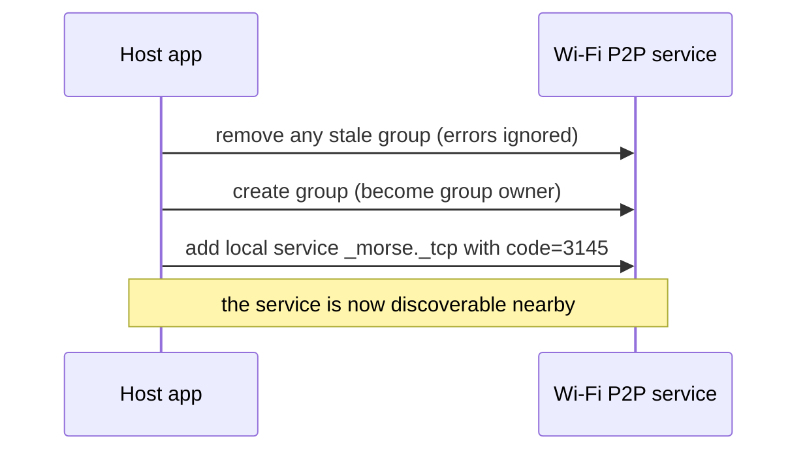
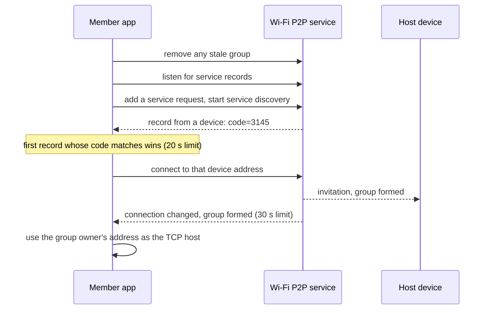

# Finding the host: Wi-Fi Direct and LAN

Before a member can open its TCP connection it needs the host's IP address.
The only thing the member knows is the 4-digit code. A **peer finder** turns
that code into an address. There are two, picked from the connection mode in
Settings each time a group is created or joined.

| | Wi-Fi Direct | LAN |
|---|---|---|
| Used on | Real watches | Emulators, the PC tools, watches on the same Wi-Fi |
| Needs a router | No | Yes, or the emulator's virtual network |
| How the host is found | Discovered over the air by its code | Typed into Settings |
| Can detect a wrong code | Only after 20 s of not finding it | Instantly, the host answers `WRONG_CODE` |
| Permission | Nearby devices (Android 13+) or fine location (Android 12 and older) | None |

## Wi-Fi Direct

Wi-Fi Direct (Wi-Fi P2P) lets devices form a small Wi-Fi network between
themselves with no access point. One device becomes the **group owner** and
acts like a tiny router; the others connect to it and get an address on its
network. Morse makes the group's host the Wi-Fi Direct group owner, so the
owner's address is exactly the TCP host address.

To find the right owner, Morse uses **DNS-SD service discovery over Wi-Fi
P2P**: the host advertises a named service with a small text record, and
joiners ask nearby devices which services they offer before any connection
exists.

| Field | Value |
|-------|-------|
| Service name | `morse` |
| Service type | `_morse._tcp` |
| Text record | `code` = the 4-digit access code |

### On the host

### On a member

Step by step:

1. **Checks.** The device must report the Wi-Fi Direct feature and the app must
   hold the permission. Otherwise the join fails at once with
   `NOT_SUPPORTED` or `PERMISSION_DENIED`, before any radio work.
2. **A clean slate.** Any group left over from a previous session is removed.
   A failure here just means there was none, so it is ignored.
3. **Listening.** A listener for service text records is registered. It
   completes the search with the advertising device's hardware address the
   first time a record carries the same code.
4. **Discovery.** A service request is added and discovery starts. If no
   matching record arrives in **20 seconds**, the join fails with
   `HOST_NOT_FOUND`.
5. **Connecting.** The member asks the system to connect to that device. The
   system negotiates the link with the host, which accepts it as group owner.
6. **Waiting for the link.** A broadcast receiver, registered as not exported
   so only the system can trigger it, listens for connection changes and asks
   for the connection info each time. The first info that says the group is
   formed completes the wait. Without it in **30 seconds**, the join fails with
   `HOST_NOT_FOUND`.
7. **The address.** The group owner's address from that info is handed to the
   TCP layer, which then performs the normal handshake on port 8765.

Every Wi-Fi P2P call reports success or a numeric failure reason through a
callback. Morse wraps each one so it can be awaited in order, maps the
"unsupported" reason to `NOT_SUPPORTED` and any other reason to the error that
fits the step, and logs the reason code.

When the group ends, the finder unregisters its receiver, clears its local
services and service requests, and removes the P2P group, releasing the radio.

### Permissions

Android 13 introduced a dedicated **Nearby Wi-Fi devices** permission,
declared as never used to derive location. Older versions require fine
location for Wi-Fi scanning. The manifest declares the location permissions
only up to Android 12, so newer watches are never asked for location.

The permission is requested from Home, just before creating or joining a
group in Wi-Fi Direct mode, and only in the full build. If it is refused,
Home shows a Wear alert with a shortcut to the app's system settings.

### Timing in practice

Discovery and link formation are radio operations and take seconds. With the
radio timings assumed in the simulation tests (group creation 0.6 to 1.5 s,
discovery 3 to 9 s, connection 2 to 6 s), two watches form a group in about
10 seconds, and the app's own TCP handshake adds about 2 milliseconds. When
three watches join at once, the group owner accepts one invitation at a time,
so the last joiner waits longest. These are modelled numbers; measuring them
on real watches is listed as next steps in the
[performance report](../../docs_planning/PERFORMANCE_REPORT.md).

## LAN mode

LAN mode skips discovery. The member connects straight to the address typed
in Settings, **Host address**, which defaults to `10.0.2.2`. Inside the Android
emulator, `10.0.2.2` is a special alias for the computer running it.

| Side | What the LAN finder does |
|------|--------------------------|
| Host | Nothing to publish. The server socket on port 8765 is enough. |
| Member | Resolves the typed address (an IP or a host name). A name that cannot be resolved fails with `HOST_NOT_FOUND`. |

This makes three setups possible:

| Setup | How the member reaches the host |
|-------|---------------------------------|
| Two emulators | The host emulator's port 8765 is forwarded to the computer with ADB, and the member connects to `10.0.2.2`, which is the computer, which forwards to the host emulator. |
| An emulator and the PC tools | The Python simulator listens on the computer's port 8765, and the emulator connects to `10.0.2.2` directly. |
| Real watches on the same Wi-Fi | The member types the host watch's IP address. |

Step-by-step instructions are in
[Demo and emulators](../development/demo-and-emulators.md).

## Adding another way to find the host

Because the socket layer only needs an address, a new discovery method, for
example Bluetooth, NFC or a QR code with the address, only has to implement
the two peer finder operations: publish a code on the host, resolve a code to
an address on a member. The protocol, the session and every screen stay as
they are.
