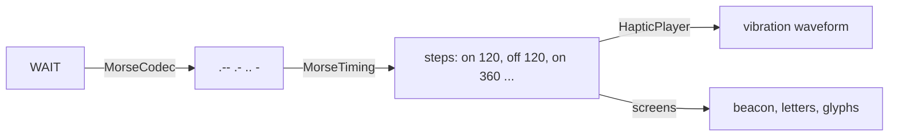

# Morse and haptics

Turning a word into something you feel takes three steps, each done by one
small piece of the core:

The same list of timed steps drives the vibration motor and every animation
on screen. That is the whole trick behind the screen lighting up in step with
the wrist.

## Encoding text

The codec turns text into a Morse string made of four characters:

| Character | Meaning |
|-----------|---------|
| `.` | Dot |
| `-` | Dash |
| space | End of a letter |
| `/` | End of a word (written with a space on each side) |

Encoding:

1. Trim the text and make it upper case.
2. Split it into words on any run of whitespace.
3. For each character, replace accented vowels with their plain letter (Á, É,
   Í, Ó, Ú and Ü become A, E, I, O, U), then look it up in the table.
4. Drop any character with no Morse code: punctuation, symbols, emoji.
5. Join the letters of a word with spaces, and the words with " / ".

The table holds the International Morse Code for A to Z and 0 to 9, plus Ñ as
`--.--`, so Spanish words keep their letter.

| Input | Output |
|-------|--------|
| Hi | `.... ..` |
| SOS | `... --- ...` |
| Sí | `... ..` |
| on my way | `--- -. / -- -.-- / .-- .- -.--` |
| ok! | `--- -.-` |

The sender encodes the word once and the Morse string travels inside the
message, so every watch plays exactly the same pattern regardless of its
language or version.

## From Morse to time

Morse timing is defined in **units**. Morse uses a unit of **120
milliseconds** by default.

| Element | Units | Milliseconds |
|---------|-------|--------------|
| Dot | 1 | 120 |
| Dash | 3 | 360 |
| Gap between symbols of a letter | 1 | 120 |
| Gap between letters | 3 | 360 |
| Gap between words | 7 | 840 |

The timing function walks the Morse string once and produces a list of
**steps**. Each step says whether the motor is on or off, for how long, and,
for "on" steps, which character of the Morse string it plays. The symbol index
is what lets a screen highlight the right dot or dash.

The rules:

- A dot or dash becomes one "on" step.
- Between two symbols of the same letter, an "off" step of 1 unit is inserted.
- A space asks for a 3-unit gap and a slash asks for a 7-unit gap. When several
  separators follow each other, the longest wins rather than adding up, so
  " / " gives exactly 7 units, not 13.
- Gaps are only written **between** symbols: the list never starts or ends
  with silence.

For **SOS** that is fifteen steps:

| Letter | Steps (ms) |
|--------|------------|
| S | on 120, off 120, on 120, off 120, on 120 |
| (gap) | off 360 |
| O | on 360, off 120, on 360, off 120, on 360 |
| (gap) | off 360 |
| S | on 120, off 120, on 120, off 120, on 120 |

3.24 seconds in total. A 20-character word can reach about 33 seconds, which is
why messages are short and the assistant shortens dictated text.

## Playing it on the motor

Android's vibrator takes a **waveform**: a list of durations that alternate
"wait, vibrate, wait, vibrate…", starting with a wait. Because the steps always
start with "on" and alternate, the waveform is simply a leading 0 ms wait
followed by every step's duration. It is played once, without repeating.

Before playing anything, the player cancels whatever is vibrating. A new
message therefore always starts immediately and is never mixed with the end of
the previous one.

On Android 12 and newer the player uses the default vibrator from the vibrator
manager; on Android 11 it uses the older vibrator service. Every pattern is
also written to the log under the `HapticPlayer` tag, which is how the
vibration can be checked on an emulator, which has no motor.

## System signals

Events use waveforms with **amplitudes**: each pulse has its own strength from
0 to 255. Morse itself is always full strength with fixed lengths, so a signal
with a soft pulse, or with pulses of unusual lengths, can never be mistaken
for a letter.

| Signal | Pattern (ms on, strength) | Character |
|--------|---------------------------|-----------|
| Sent | 40 at full | One crisp tick |
| Connected | 50 soft (110), pause 70, 110 full | Rising, "hello" |
| Not sent | 45 full, pause 55, three times | Urgent triple tick |
| Someone left | 60 full, pause 80, 220 soft (90) | Falling, fading |
| Connection lost | 320, pause 120, 320, both at 200 | Two long, heavy buzzes |

## Keeping the screen in step

Screens that show a word playing (Incoming, Welcome, Learn) build the same
step list from the same Morse string and unit, and walk it with coroutine
delays. At each step they publish:

| Value | Used by |
|-------|---------|
| The active symbol index, or none during a gap | The glowing dot or dash in the visualiser, the beacon |
| Whether that symbol is a dash | The beacon's shape and its "Short buzz" or "Long buzz" label |
| Whether playback has finished | Turning every letter and symbol white |

The screen starts its walk at the same moment the vibration starts: when the
word arrives, when replay is tapped, or (on the welcome) after a 700 ms pause
so the eyes are on the screen first. Because the motor and the screen follow
the same durations, they stay together for the length of a word; there is no
clock shared between them, so over very long words a few milliseconds of
drift are possible and not perceptible.

**Letters.** To colour the word letter by letter, the screen finds where each
letter starts in the Morse string, works out which letter contains the active
symbol, and counts only characters that have a Morse code, so punctuation in
the word does not shift the colours.

**Learn Morse** uses three times the normal unit (360 ms) for both the motor
and the screen, so SOS lasts about ten seconds and each beat can be counted.

**The edge ring** for messages that arrive while you are busy walks the same
steps, turning the ring on and off.

## Verified by tests

The codec and timing have their own unit tests: the table, accents and Ñ, the
dropping of unsupported characters, word separators, gap merging, the
waveform's leading zero, and the symbol indexes. A micro-benchmark confirms
encoding and timing a word take about one to two microseconds on a desktop.
See [Testing](../development/testing.md).
