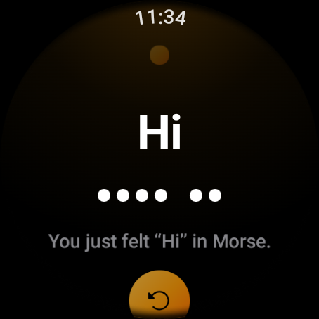
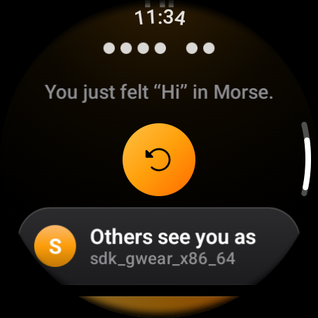
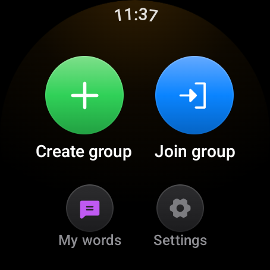
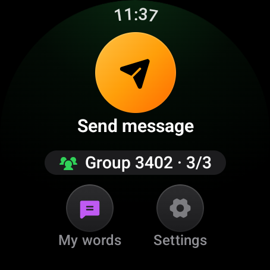

# Getting started

This guide takes you from installing Morse on a watch to feeling your first
message. You need nothing else: no phone, no account and no internet.

## What you need

| Item | Details |
|------|---------|
| A Wear OS watch | Wear OS 3 or newer (Android 11, API 30+). Round and square faces, small and large, are all supported. |
| Two more watches, for real groups | A group holds up to three watches. To try the app alone, use the demo build described below. |
| Wi-Fi Direct | Every Wear OS watch with Wi-Fi has it. Emulators do not, so they use the LAN mode instead. |

## Install

Morse is installed from a computer with the Android SDK, the same way any
Wear OS app is sideloaded during development.

1. On the watch, turn on Developer options (Settings, System, About, tap the
   build number seven times), then turn on ADB debugging and Debug over Wi-Fi.
2. Connect the computer to the watch with the address the watch shows.
3. From the project folder, install the build you want. The two builds are
   explained in the next section.

| Build | Install command | Shows up on the watch as |
|-------|-----------------|--------------------------|
| Full (the real app) | `./gradlew :app:installFullDebug` | Morse |
| Demo (simulated watches) | `./gradlew :app:installDemoDebug` | Morse Demo |

Both builds can live on the same watch side by side. The full guide to
building is in [Building and running](../development/building.md).

## Full or demo?

- **Full** is the app you use with friends. Watches find each other over
  Wi-Fi Direct, and there is a LAN mode for emulators and for joining a group
  hosted by the PC tools.
- **Demo** is the same app with fake group members. When you create a group,
  two simulated watches join a moment later and answer every word you send.
  It exists so the whole experience can be shown on a single watch or
  emulator, for example in a class presentation.

## First start

The first time you open Morse it explains itself by doing it. After a short
pause the watch vibrates the word **Hi** (**Hola** in Spanish) in Morse. While
your wrist buzzes, the letters fill in and the dots and dashes light up one by
one, in time with the vibration. When it finishes, one line tells you what you
just felt.

Scroll down for two more rows:

| Row | What it does |
|-----|--------------|
| Others see you as | The name the rest of the group sees. It starts as the watch's own name; tap it to type or dictate a better one (up to 20 characters). |
| Start | Closes the welcome and opens Home. |

The replay button plays the word again as many times as you like. The welcome
appears only once; swiping it away counts as seen.

## Home

Home always shows the one thing to do next.

- **Not in a group:** two large buttons, **Create group** and **Join group**.
- **In a group:** one large orange **Send message** button and, under it, a
  chip with the group code and how many watches are in it (for example
  "Group 3402 · 3/3"). Tap the chip to open the group.

Two shortcuts sit at the bottom of the face: **My words** (your own word list)
and **Settings**.

The first time you create or join a group with the full build, the watch asks
for the **Nearby devices** permission (on older watches, location). Morse needs
it to find the other watches over Wi-Fi Direct. If you refuse, a message
explains why and offers a button straight to the app's system settings.

## Your first message

1. One person taps **Create group**. A 4-digit access code appears.
2. Everyone else taps **Join group**, dials in the code with the four wheels
   and taps **Join**.
3. Anyone taps **Send message** and picks a word, for example **Yes**.
4. Every other watch vibrates the word in Morse and shows it lighting up.

The next pages explain each step in detail:

| Page | What it covers |
|------|----------------|
| [Groups](groups.md) | Creating, joining, the three group pages, leaving |
| [Messages](messages.md) | Sending, dictation, receiving, replies, your own words |
| [Reading Morse by feel](reading-morse.md) | The rhythm of dots and dashes, the system signals, Learn Morse |
| [Settings](settings.md) | Your name, language, signals, connection mode |
| [Troubleshooting](troubleshooting.md) | What each error means and how to fix it |
