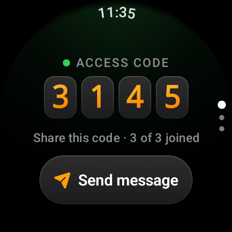
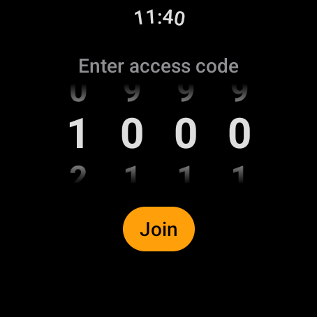
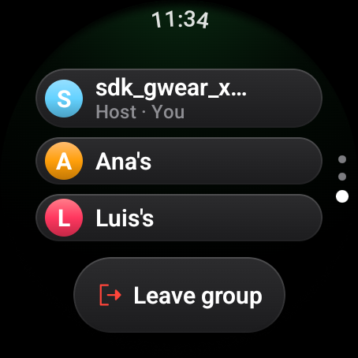

# Groups

A group is up to three watches that feel each other's messages. One watch
creates it and becomes the **host**; the others **join** with its access code.
Nothing leaves the group: messages go from watch to watch, never through a
server.

## Creating a group

Tap **Create group** on Home. The watch prepares the group (a spinner and an
orange breathing dot) and then shows the group's **access code**: four digits
chosen at random, rolling into place on glass tiles. The dot turns green when
the group is ready.

Under the code, a line says how many watches have joined so far, for example
"Share this code · 2 of 3 joined". Read the code out loud or show the screen to
the others. When the third watch joins, the code has done its job and the host
is taken to the messages page automatically.

## Joining a group

Tap **Join group** on Home. Four wheels show the digits of the code; swipe
each one up or down to the right digit, then tap **Join**.

While the watch looks for the host it shows **Connecting…**. Over Wi-Fi Direct
this takes about ten seconds, because the watches have to find each other over
the air before they can talk. When it works, the watch vibrates the
**Connected** signal and opens the group.

If something goes wrong the reason is shown in red with a **Try again** button:

| Message | What it means |
|---------|---------------|
| Wrong access code | A host answered, but with a different code (LAN mode). |
| The group is full | The host already has three watches. |
| No group found with that code | No watch nearby advertises that code. Check the digits and that the host is still on the code page. |
| Can't reach the host | The host was found but did not accept the connection. |

More causes and fixes are in [Troubleshooting](troubleshooting.md).

## The group screen

The group screen has three pages stacked vertically. Swipe up and down to move
between them; the dots on the right edge show where you are. The host starts
on the code page, people who joined start on the messages page, because they
already know the code.

| Page | What is on it |
|------|---------------|
| Access code | The code, a status dot (orange while connecting, green when connected, red on error), how many have joined, and a **Send message** button. |
| Messages | The big **Send message** button and the last message received, with its Morse. Tap the message to open it again. |
| People | Everyone in the group, each with a coloured initial. The host is tagged **Host** and you are tagged **You**. **Leave group** is at the bottom. |

Each person keeps the same colour on every screen and every watch, because
the colour comes from the name itself.

The background tint follows the connection: green while connected, red after
an error, orange while connecting.

## When someone joins or leaves

You do not need to look. Morse has a vibration for each event, different from
any Morse letter:

| You feel | It means |
|----------|----------|
| A soft tap, then a strong one | You are connected to the group. |
| A strong tap, then a long soft one | Someone left the group. |
| Two long, even buzzes | You lost the connection to the group. |

All signals can be felt on demand in Settings. See
[Reading Morse by feel](reading-morse.md#the-system-signals).

## Leaving

Go to the people page and tap **Leave group**. A confirmation asks first:

- If you joined, you simply stop feeling the group's messages; the others
  continue.
- If you are the host, the group **ends for everyone**, because the host is
  the watch that connects the others.

If the connection is lost, the code page shows **Connection lost** with
**Start over** (if you joined) or **Retry** (if you were the host).

## Staying connected with the screen off

While you are in a group, Morse keeps running in the background so messages
still arrive when the screen is off or when you open another app. The watch
shows an ongoing notification, **Connected to your group**; tapping it opens
Morse. The notification disappears as soon as you leave the group.
