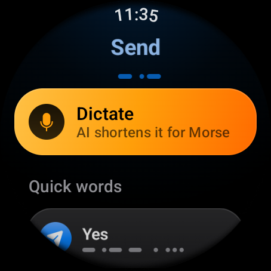
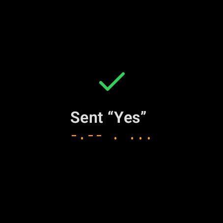
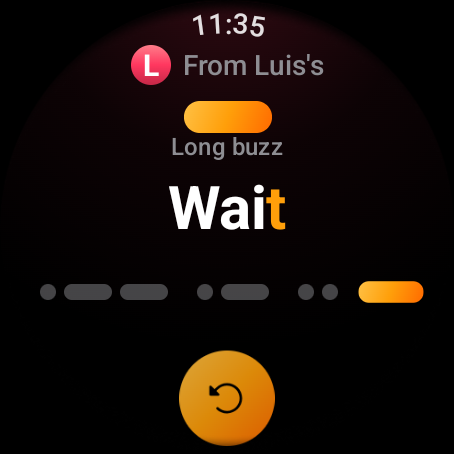
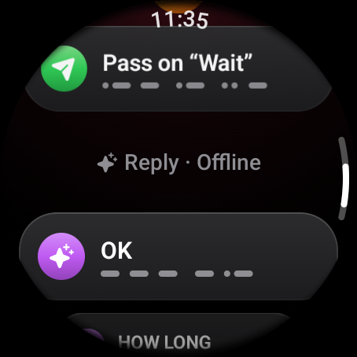
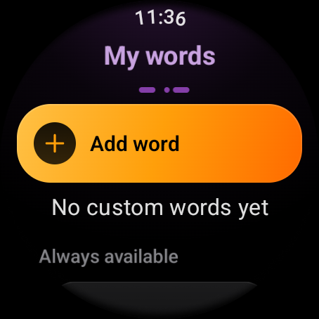

# Messages

A Morse message is one short word or phrase, up to 20 characters. Short on
purpose: each letter takes about a second to vibrate, so a long sentence would
keep everyone's wrist buzzing for half a minute.

## Sending a word

Tap **Send message** on Home or in the group. The Send screen lists everything
you can send, each with its Morse drawn underneath as dots and dashes.

| Section | What it holds |
|---------|---------------|
| Dictate | Say or type a sentence and let the app shorten it (see below). |
| Quick words | Five words that are always there: Yes, No, Maybe, I'm here, Wait (Sí, No, Quizás, Aquí estoy, Espera in Spanish). |
| My words | The words you added yourself, if any. |

Tap a word to send it. You get an answer every time:

- **Sent.** A green check with the word and its Morse appears for a moment,
  the watch gives one short tap, and you go back to where you were.
- **Not sent.** If the word could not leave the watch, you feel three quick
  taps and an alert says "*word* wasn't sent" with **Retry** and **Cancel**.

If you are not in a group, the Send screen says **Not in a group** at the top
and every word is greyed out. Tap that row to go back to Home and create or
join one.

## Dictating a longer message

**Dictate** opens the watch's own input screen, where you can speak, type or
draw. Say what you mean in plain words, for example "I will be there in ten
minutes please wait". Morse then shows the **Shortened** screen:

| Part | What it shows |
|------|---------------|
| Your sentence | What you said, in quotes, for reference. |
| Send this | The shortened version, ready to send with one tap. Its label says **AI** when it was written by the online model, or **Offline** when the built-in rules did it. |
| Seconds saved | Two bars comparing how long each version takes to vibrate, and how many seconds of buzzing the short one saves. |
| As dictated | Your original text, when it already fits in 20 characters, in case you prefer it. |

Shortening keeps who, where, when and yes or no, drops filler words, and uses
digits and common abbreviations (OK, MIN, ETA). How it works, online and
offline, is described in [AI assistant](../internals/ai-assistant.md).

## Receiving a message

When a word arrives your wrist plays it in Morse straight away, even with the
screen off. What you see depends on what you were doing:

- **On Home, already looking at a message, or with Morse closed:** the
  **incoming** screen opens and plays the word.
- **Anywhere else in the app** (sending, editing your words, in Settings):
  Morse does not pull you out. Instead, a green ring around the edge of the
  screen lights up in time with the vibration, so you still see the rhythm. The
  message is waiting on the group's messages page.

The incoming screen is built to be read by feel and confirmed by eye:

| Part | What it does |
|------|--------------|
| From | Who sent it, with their coloured initial. |
| Beacon | A light above the word that is on exactly while your wrist buzzes: a round dot for a short buzz, a wide bar for a long one, named underneath ("Short buzz", "Long buzz"). |
| The word | Letters you have already felt turn white, the letter vibrating now is orange, the rest are dim. |
| The Morse | Every dot and dash of the word in a row. The one vibrating now swells and glows. |
| Replay | Plays the word again, on the wrist and on screen. |

In the screenshot above the watch is in the middle of "Wait": "Wai" has been
felt, "t" is playing, and it is a long buzz (a dash).

## Answering

Scroll under the message for two ways to answer:

- **Pass on "*word*"** sends the same word to the rest of the group, which is
  how a message travels when not everyone heard it. It is not offered for your
  own messages.
- **Reply** suggests three short answers based on the conversation so far, for
  example "Yes", "No", "Maybe" to a question, or "On my way", "Where",
  "Call 911" to an SOS. While they are being prepared you see "Finding
  replies…". The header says **AI** or **Offline**, just like dictation.

Sending a reply or passing a word on works like any other send: a check when
it went out, an alert to retry when it did not.

## My words

**My words** on Home holds the words you send often. Each appears on the Send
screen under the quick words.

- **Add word** opens the watch's input screen. Words can be up to 20
  characters. Adding a word you already have, in any capitalisation, says
  "Already in your words".
- Tap a word to delete it; a confirmation asks first.
- The quick words are listed at the bottom under **Always available**. They
  cannot be removed.

Your words are kept on the watch and survive restarts and updates.

## What can be sent

Morse carries letters A to Z, the digits 0 to 9 and the Spanish **Ñ**. Accented
vowels (á, é, í, ó, ú, ü) are sent as their plain letter. Spaces separate
words. Anything else, such as punctuation or emoji, has no Morse code and is
silently left out of the vibration; the text still shows it as written.
