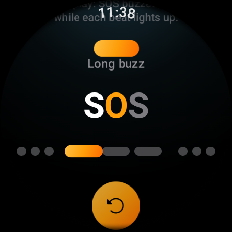

# Reading Morse by feel

The vibration is the message. The screen is there to help you learn, but the
goal of Morse is that after a while you recognise the words your group uses
just by how they feel on your wrist.

## The rhythm

Morse code is built from two kinds of buzz and three kinds of silence. Morse
measures them all in **beats**. One beat lasts 120 milliseconds, about the
time of a quick tap.

| You feel | Length | Drawn as |
|----------|--------|----------|
| Short buzz (dot) | 1 beat | A round dot |
| Long buzz (dash) | 3 beats | A wide capsule |
| Pause inside a letter | 1 beat | The small gap between dots and dashes |
| Pause between letters | 3 beats | A wider gap |
| Pause between words | 7 beats | A thin vertical bar on screen |

So the letter **S** is three quick taps, **O** is three long buzzes, and
**SOS** feels like *tap tap tap, buzz buzz buzz, tap tap tap*.

With these timings, common words take a few seconds each:

| Word | Time on the wrist |
|------|-------------------|
| No | about 2.3 s |
| Yes | about 3.0 s |
| Wait | about 3.5 s |
| I'm here | about 5.4 s |
| Maybe | about 5.6 s |
| 20 characters | up to about 33 s |

This is why Morse keeps messages short and offers to shorten dictated ones.

## Learn Morse

Settings has a **Learn Morse** page. Tap replay and the watch plays **SOS** at
one third of the normal speed, slow enough to count the beats as they come.
Like the incoming screen, the beacon lights up exactly while the wrist buzzes
and names it ("Short buzz", "Long buzz"), the current letter turns orange and
the dot or dash being played glows.

Under the word, a legend lists the four timings to count in beats, each with
its own drawing: short buzz 1, long buzz 3, pause between letters 3, pause
between words 7.

**Feel a sample (SOS)** in Settings plays the same word at normal speed, which
is the fastest way to show someone what the app does.

## Tips for learning

- Start with the five quick words. They are the ones your group will send most.
- Watch the incoming screen while you feel a word, then press **Replay** with
  your eyes closed.
- Count beats, not milliseconds: a long buzz is as long as three short ones.
- Letters are easier than words. The welcome word, **Hi**, is four taps, a
  pause, then two taps.

## The system signals

Besides messages, Morse uses five vibrations to tell you what happened without
looking. They are made from taps of different strength, a pattern no Morse
letter can produce, so you never confuse a signal with a message.

| Signal | How it feels | When |
|--------|--------------|------|
| Connected | A soft tap, then a strong one | You created or joined a group. |
| Sent | One short, strong tap | Your word left the watch. |
| Not sent | Three quick strong taps | Your word could not be sent. |
| Someone left | A strong tap, then a long soft buzz | A member left the group. |
| Connection lost | Two long, even buzzes | You were in a group and the connection dropped. |

Each one can be felt on demand under **Signals you feel** in Settings.

A new vibration always replaces the one in progress. If a message arrives
while another is still playing, the new one starts right away.
