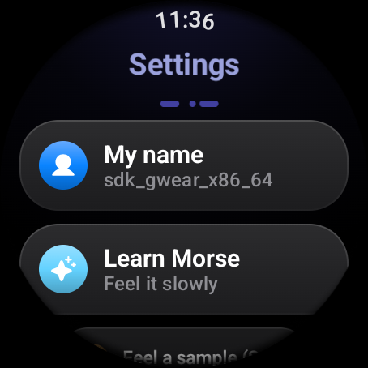
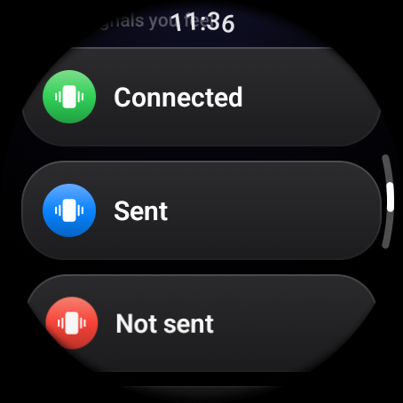
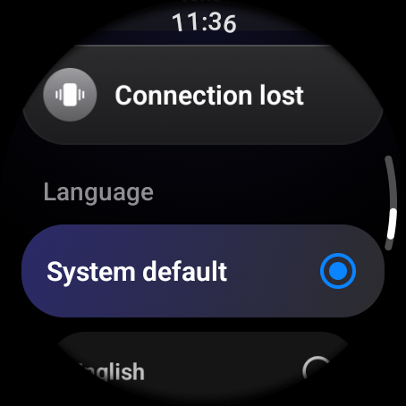

# Settings

Open **Settings** from the gear at the bottom of Home. Every change applies
immediately and is remembered on the watch.

## My name

The name the other watches see next to your messages and in the people list.
By default it is the watch's own device name. Tap **My name** to type or
dictate another one.

- Up to 20 characters. Extra spaces are removed.
- Other screens show only the first word, so "Juan Diego" appears as "Juan".
- **Use device name** appears once you have set your own name, and goes back to
  the watch's name.

When two watches have the same device name, as happens with two emulators, set
a different name on each so you can tell who sent what.

## Learn Morse and Feel a sample

**Learn Morse** plays SOS slowly with every beat lit and named. **Feel a sample
(SOS)** plays it at normal speed. Both are described in
[Reading Morse by feel](reading-morse.md).

## Signals you feel

The five vibrations Morse uses for events: Connected, Sent, Not sent, Someone
left and Connection lost. Tap one to feel it. What each means is in
[The system signals](reading-morse.md#the-system-signals).

## Language

| Option | Result |
|--------|--------|
| System default | Follows the watch's language: Spanish if the watch is in Spanish, English otherwise. |
| English | Always English. |
| Español | Always Spanish. |

The screen reloads in the new language straight away; there is no need to
restart the app. The language also decides which words the AI suggests and
the word played on the welcome screen.

## Smart replies status

A line under the language options says whether smart replies and dictation
use the online model:

- **Smart replies: AI on** means the build includes an AI key. Suggestions come
  from the model when the watch is online, and from the offline rules when it
  is not.
- **Smart replies: basic (offline)** means there is no key, so the built-in
  rules are always used.

How the key is added is explained in
[Building and running](../development/building.md#turning-on-online-ai).

## Demo and testing

This section exists only in the full build. The demo build always simulates
the group, so a connection choice would do nothing there.

| Option | What it does |
|--------|--------------|
| Wi-Fi Direct | The default. Watches find each other over the air. Use this on real watches. |
| Local network (emulator) | Joins a host at a fixed address over the local network. Use it with emulators or with the PC tools. |
| Host address | Shown only in the local network mode. The address of the host to join. The default, 10.0.2.2, is the computer running the emulator. |

The choice applies the next time you create or join a group. How each mode
works is explained in [Connection](../internals/connection.md), and the
emulator setups are step by step in [Demo and emulators](../development/demo-and-emulators.md).
